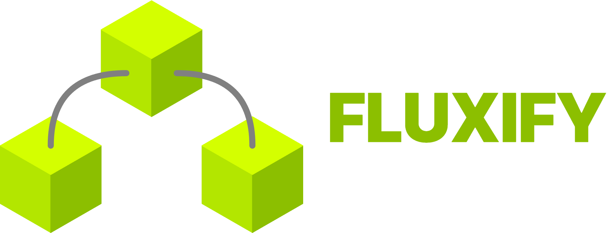
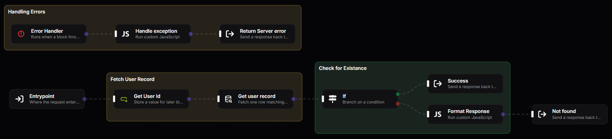

<div align="center">

  

  <p><b>The production-grade, low-code agentic backend platform.</b><br />
  <i>Build, orchestrate and scale APIs and workflows visually.</i></p>

  <p>
    <a href="LICENSE"></a>
    
    <a href="https://docs.fluxify.rest" target="_blank" rel="noopener noreferrer"></a>
  </p>

  <a href="https://www.fluxify.rest" target="_blank" rel="noopener noreferrer">
    
  </a>

</div>

---

Fluxify turns a visual workflow into a real, compiled API. You draw the flow, and
it is translated into JavaScript once, when you save. Requests run that code
directly, with no graph walking.

## Features

- Visual canvas builder, compiled to JavaScript on save and run on Bun
- AI route builder: bring OpenAI, Anthropic, Gemini, Mistral or any OpenAI-compatible model
- PostgreSQL, MySQL and MongoDB blocks, plus raw queries and transactions
- Redis and Memcached, with loops, conditions, retry and error handling as blocks
- Workflows on cron, interval, one-off or message triggers (Kafka, NATS and SQS in Enterprise)
- JavaScript blocks, reusable custom blocks and built-in test suites
- Versioning, promotion and deployments
- Logs and tracing to console, Grafana Loki or OpenTelemetry
- Self-host with one container, split admin and workers, or Helm on Kubernetes

## Getting started

Run the whole platform in one container:

```bash
docker run -d --name fluxify \
  -p 8080:8080 \
  -v fluxify_data:/data \
  -e SEED_USER_EMAIL=admin@example.com \
  -e SEED_USER_PASSWORD=ChangeThisPassword123! \
  ghcr.io/fluxify-rest/fluxify-kit:nightly
```

Then open `http://localhost:8080/_/admin/ui` and log in with the email and password you set.

For production, see <a href="https://docs.fluxify.rest/deployments/production" target="_blank" rel="noopener noreferrer">admin, orchestrator and scaled workers</a>
and <a href="https://docs.fluxify.rest/deployments/production#image-tags" target="_blank" rel="noopener noreferrer">which image tag to pull</a>.

## Learn more

- <a href="https://docs.fluxify.rest/getting-started/" target="_blank" rel="noopener noreferrer">What is Fluxify</a> and <a href="https://docs.fluxify.rest/concepts/" target="_blank" rel="noopener noreferrer">core concepts</a>
- <a href="https://docs.fluxify.rest/blocks/" target="_blank" rel="noopener noreferrer">Blocks</a>, including <a href="https://docs.fluxify.rest/blocks/custom-blocks" target="_blank" rel="noopener noreferrer">custom blocks</a>
- <a href="https://docs.fluxify.rest/architecture/" target="_blank" rel="noopener noreferrer">Architecture</a> and <a href="https://docs.fluxify.rest/architecture/performance" target="_blank" rel="noopener noreferrer">performance benchmarks</a>
- <a href="https://docs.fluxify.rest/integrations/" target="_blank" rel="noopener noreferrer">Integrations</a>: databases, key-value stores, message queues, AI models, observability

---

## Contributing

Fluxify is a Bun monorepo. From a fresh clone to a running stack takes five
commands: see the <a href="https://docs.fluxify.rest/getting-started/contributing" target="_blank" rel="noopener noreferrer">contributing guide</a> or [CONTRIBUTING.md](CONTRIBUTING.md). Opening a pull request accepts
the [CLA](CLA.md), and there is nothing to sign.

## License

Apache License 2.0 for the open-source code ([LICENSE](LICENSE)). Code in `ee/`
directories and `*.ee.*` files is under the
[Enterprise Edition License](LICENSE_EE): free for personal, educational and
non-profit use, and a license key for commercial use. See
<a href="https://docs.fluxify.rest/deployments/licensing" target="_blank" rel="noopener noreferrer">Editions and licensing</a>.

## Links

<a href="https://docs.fluxify.rest" target="_blank" rel="noopener noreferrer">Documentation</a> · <a href="https://www.fluxify.rest" target="_blank" rel="noopener noreferrer">Website</a> · <a href="https://github.com/Fluxify-rest/Fluxify/issues" target="_blank" rel="noopener noreferrer">Issues</a> · <a href="https://github.com/Fluxify-rest/Fluxify/discussions" target="_blank" rel="noopener noreferrer">Discussions</a>
